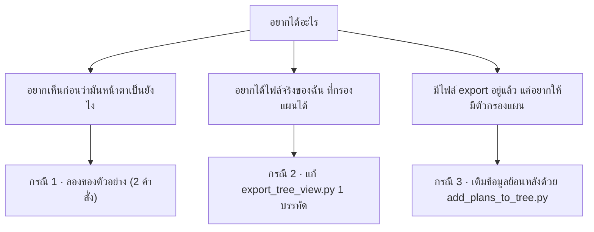

# เริ่มตรงนี้ — วิธีใช้ "ตัวกรองแผน" ใน 1 นาที

> สรุปสั้น: มีไฟล์ใหม่ 1 ไฟล์ที่ต้องใช้จริง (`tree_view.html`)
> ที่เหลือเป็นตัวช่วย (จะใช้หรือไม่ใช้ก็ได้) — ไม่ต้องรันทุกคำสั่งที่เคยเขียนไว้

---

## 0) เลือกว่าคุณอยู่กรณีไหน



---

## กรณี 1 — แค่อยากเห็นว่ามันทำงานยังไง (ทำอันนี้ก่อนก็ได้)

เปิด Command Prompt / Terminal ในโฟลเดอร์โปรเจกต์ แล้วพิมพ์ **2 บรรทัดนี้**:

```bash
py build_preview.py tree_view.html data_tree_demo.json tree_demo.html
```

```bash
start tree_demo.html          # Windows
# macOS: open tree_demo.html
# Linux: xdg-open tree_demo.html
```

**จะเห็นอะไร:** หน้าเว็บมี dropdown **แผน** เพิ่มมา และมีปุ่มชิปแบบนี้

```
วิชาบังคับตามแผน:  [ทุกแผน 120 นก.] [PROJECT 108 นก.] [COOP 114 นก.] [OVERSEA_TRAINING 114 นก.]
```

- เปิดมาตั้งแต่แรกจะเลือก **PROJECT** ให้อัตโนมัติ → เลขคือ 108 (เลขที่ต้องเรียนจริง)
- กด **COOP** → 114 / กด **ทุกแผน** → 120 (เพราะรวมสหกิจ + ฝึกงานต่างประเทศเข้าด้วยกัน)
- วิชาที่บังคับเฉพาะแผนจะมีป้าย `แผน COOP` ต่อท้าย

> ไฟล์ `tree_demo.html` นี้เป็นแค่ของลอง — ไม่ต้องเอาไปใช้จริง ลบทิ้งได้

---

## กรณี 2 — อยากได้ไฟล์จริง (แนะนำ ถ้าแก้สคริปต์ได้)

เพิ่มข้อมูล 2 อย่างใน `export_tree_view.py` (รายละเอียดเต็มใน `README.md` §4.1)

**① รายการแผนของหลักสูตร** — ใส่ใน dict ของหลักสูตร:

```python
"plans": [{"id": p.id, "code": p.code, "name": p.name} for p in curriculum.study_plans],
```

**② แผนของแต่ละรายวิชา** — ใส่ตอนแปลง `CurriculumCourse` เป็น dict:

```python
"plan_code": cc.study_plan.code if cc.study_plan else None,
```

แล้ว export ตามปกติ:

```bash
python export_tree_view.py
python check_export.py tree_view.html schedule_view.html
```

เท่านี้ dropdown แผนในหน้า tree จะใช้ได้เลย ไม่ต้องใช้สคริปต์อื่นอีก

---

## กรณี 3 — ไม่อยากแตะ `export_tree_view.py`

ถ้าคุณ**มีไฟล์ export อยู่แล้ว** (`tree_view.html` + `schedule_view.html` ที่มีข้อมูลจริง)
สั่ง 1 บรรทัดนี้เพื่อสร้างไฟล์ใหม่ที่มีข้อมูลแผน:

```bash
py add_plans_to_tree.py tree_view.html schedule_view.html --template tree_view.html --out-html tree_view_plans.html
```

- อ่านแผนจากไฟล์ **schedule** (ซึ่งรู้ว่าแต่ละแถวอยู่แผนไหน) แล้วจับคู่ด้วย **รหัสวิชา**
- ได้ `tree_view_plans.html` → ดับเบิลคลิกเปิดใช้แทนไฟล์เดิมได้เลย
- ถ้าอยากได้แค่ JSON ไปใช้ต่อ: `--out build/data_tree.json` แล้ว
  `py build_preview.py tree_view.html build/data_tree.json out.html`

**อ่านผลลัพธ์:** ดูบรรทัด `วิชาที่ติด plan_codes : N` — ถ้าเป็น 0 แปลว่าจับคู่ไม่ได้
(มักเกิดจากสองไฟล์มาจากฐานข้อมูลคนละรุ่น) ให้ export ใหม่ทั้งคู่แล้วรันซ้ำ

---

## ตรวจว่าตัวเลขถูก (แนะนำทุกครั้งหลัง export)

```bash
py check_export.py tree_view_plans.html schedule_view.html
```

จะได้บรรทัดแบบนี้ ซึ่งเป็นการพิสูจน์ว่าปิดบั๊ก "หน่วยกิตเกิน 12 นก." แล้วจริง:

```
=== เทียบหน่วยกิตวิชาบังคับตามแผน: tree vs schedule ===
  • วิศวกรรมไอโอทีและสารสนเทศ (2569)
      PROJECT: tree 108 = schedule 108 นก. ✓
      COOP: tree 114 = schedule 114 นก. ✓
```

---

## เมนูเชื่อมสองหน้า (ของใหม่)

ทั้ง `tree_view.html` และ `schedule_view.html` มี **เมนูด้านซ้าย** เหมือนกัน ใช้สลับไปมาระหว่างสองหน้าได้เลย
และ **จำหลักสูตร + แผนที่กำลังดูอยู่** ไว้ให้ด้วย (ส่งต่อผ่าน `?cur=<ลำดับหลักสูตร>&plan=<รหัสแผน>`)

```
📚 หมวดวิชา  (Tree View)      ← คลิกสลับหน้าได้
📅 แผนการศึกษารายเทอม
────────────────────────────
จะเปิดด้วย: วิศวกรรมไอโอที… • แผน COOP
```

- ต้องวางไฟล์ทั้งสองไว้ **โฟลเดอร์เดียวกัน**
- ถ้าเปลี่ยนชื่อไฟล์ ให้แก้บรรทัดนี้ใน `<script>` ของ **ทั้งสองไฟล์**:
  `const NAV_FILE = { tree: 'tree_view.html', schedule: 'schedule_view.html' };`
  (ถ้าเปลี่ยนชื่อให้มี suffix เดียวกัน เช่น `*_2569.html` ไม่ต้องแก้ ระบบเดาชื่อคู่ให้เอง)
- ตรวจว่าต่อสายครบหรือไม่: `py verify_nav.py`

---

## ไฟล์ไหนต้องใช้ / ไม่ต้องใช้

| ไฟล์ | ต้องใช้ไหม | ใช้ตอนไหน |
|---|---|---|
| `tree_view.html` | ✅ **ใช้** (แทนของเดิม) | ตัวเว็บที่มีตัวกรองแผน |
| `check_export.py` | ✅ แนะนำ | ตรวจหลัง export ทุกครั้ง |
| `verify_nav.py` | ✅ แนะนำ | ตรวจเมนูเชื่อมสองหน้าว่าต่อสายครบ (ไม่ต้องเปิดเบราว์เซอร์) |
| `add_plans_to_tree.py` | เฉพาะกรณี 3 | เติมข้อมูลแผนย้อนหลัง |
| `data_tree_demo.json` | ❌ ของทดสอบ | ใช้ในกรณี 1 เท่านั้น |
| `build_preview.py` | ❌ ถ้า export เต็มแล้ว | ดูตัวอย่างก่อน export |
| `README.md` | อ่านเมื่ออยากเข้าใจ | §4.1 (schema แผน), §7.4 (คำสั่ง), §8 (known issues) |
| `schedule_view.html`, `split_course_pool.py`, `courses_*.json` | ❌ ไม่เกี่ยวกับงานนี้ | เป็นงานลดขนาดไฟล์ของรอบก่อน |

---

## ถ้าเจอปัญหา

| อาการ | สาเหตุ | แก้ |
|---|---|---|
| `'py' is not recognized` | Windows ไม่มี launcher `py` | ใช้ `python` หรือ `python3` แทน |
| เปิด `tree_view.html` ตรง ๆ แล้วหน้าว่าง | ยังเป็นเทมเพลต มี `__DATA_JSON__` ค้างอยู่ | ต้อง export / build ก่อน (กรณี 1–3) |
| dropdown แผนกดไม่ได้ + แบนเนอร์เหลือง | ข้อมูลไม่รู้ว่าแต่ละวิชาอยู่แผนไหน | ใช้กรณี 2 หรือ 3 |
| ขึ้น 120 ทั้งที่ต้องเป็น 108 | ยังเลือก "ทุกแผน" อยู่ | เลือก **PROJECT** จาก dropdown |
| `check_export.py` ฟ้อง `tree 120 ≠ schedule 108` | ไฟล์ tree ยังไม่มี `plan_code` | ใช้กรณี 3 เติมก่อน |
| ชื่อหลักสูตรใน tree กับ schedule ไม่ตรงกัน | สองไฟล์ export คนละรอบ | export ใหม่ทั้งคู่จากฐานข้อมูลเดียวกัน |
| คลิกเมนูด้านซ้ายแล้วขึ้น "ไม่พบไฟล์" | สองไฟล์อยู่คนละโฟลเดอร์ หรือชื่อไฟล์ไม่ตรงกับ `NAV_FILE` | วางไฟล์ไว้โฟลเดอร์เดียวกัน / แก้ `NAV_FILE` (§ เมนูเชื่อมสองหน้า) |
| ข้ามหน้าแล้วแผนไม่ตามมา | ข้อมูลฝั่ง tree ไม่มี `plan_code` ของแผนนั้น | เติมด้วยกรณี 3 แล้วดูกลุ่ม G ของ `verify_nav.py` |
| เมนูไม่ขึ้นเลย | ไฟล์ที่เปิดเป็นเทมเพลต/รุ่นเก่าที่ยังไม่มีเมนู | `py verify_nav.py` จะบอกว่าหัวข้อ A/B ไม่ผ่านข้อใด |
