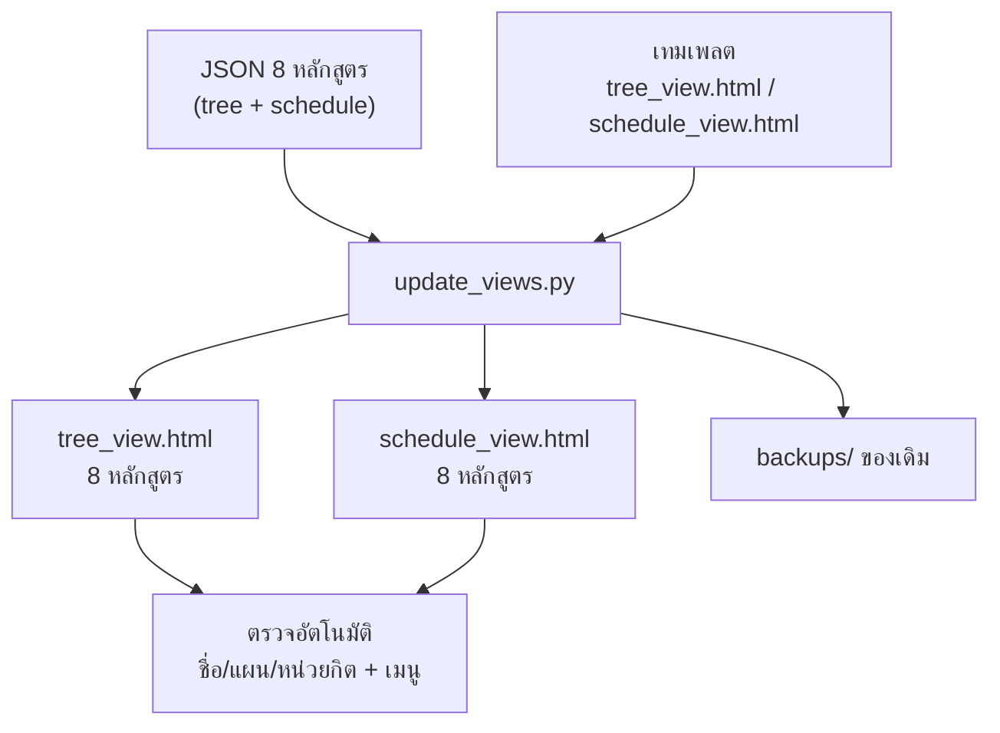

# อัปเดตสองหน้า HTML ให้แสดงข้อมูลใหม่ (8 หลักสูตร) — คู่มือสั้น

> **สรุปสุดท้าย:** ข้อมูล JSON พร้อมแล้ว → รัน **1 คำสั่ง** แล้วได้ทั้ง `tree_view.html` และ `schedule_view.html`
> ที่มีเมนูเชื่อมกันและจำหลักสูตร/แผนที่เลือกอยู่
>
> ```bash
> py update_views.py --tree-data data_tree_2569.json --schedule-data data_sched_2569.json
> ```

---

## 0) ไฟล์ที่ต้องมีในโฟลเดอร์เดียวกัน

| ไฟล์ | บทบาท | ต้องมีไหม |
|---|---|---|
| `update_views.py` | ตัวรัน (คำสั่งเดียวจบ) | ✅ |
| `tree_view.html` | **เทมเพลต** หน้าแรก (ยังมี `__DATA_JSON__`) | ✅ (ครั้งแรกเท่านั้น) |
| `schedule_view.html` | **เทมเพลต** หน้าที่สอง (มี `__DATA_JSON__` + `__COURSE_POOL__`) | ✅ (ครั้งแรกเท่านั้น) |
| ข้อมูล JSON หน้า tree | มีคีย์ `"tree"` (หมวด/วิชา + `plans`) | ✅ |
| ข้อมูล JSON หน้า schedule | มีคีย์ `"data_by_plan"` | ✅ |
| `courses.json` (คลังวิชา) | มีก็ได้ ถ้าไม่ให้สคริปต์จะสร้างจาก `options` ในข้อมูล | ไม่บังคับ |
| `verify_nav.py`, `check_export.py` | ตัวตรวจที่จะถูกรันอัตโนมัติ | แนะนำให้มี |
| `split_course_pool.py` | ตัวย่อคลังวิชา (สคริปต์เรียกใช้เองถ้ามี) | ไม่บังคับ |

> **เทมเพลตคือหัวใจ** — ทั้งสองหน้าเป็นไฟล์ HTML ที่มีป้าย `__DATA_JSON__` ค้างอยู่
> ตัวรันจะ **อ่านเทมเพลต → เติมข้อมูล → เขียนทับไฟล์ชื่อเดิม**
> รอบแรกสคริปต์จะคัดลอกเทมเพลตเก็บไว้เป็น `tree_view_template.html` / `schedule_view_template.html`
> **ตั้งแต่รอบที่ 2 เป็นต้นไป ให้แก้ที่ไฟล์ `*_template.html`** (ไฟล์ `tree_view.html` กลายเป็นผลลัพธ์แล้ว)

---

## 1) ขั้นตอนทั้งหมด (ภาพรวม)



คำสั่งเดียวจะทำ 6 อย่างให้: **อ่านข้อมูล → เตรียมเทมเพลต → จัดการคลังวิชา → เขียนไฟล์ → เทียบข้อมูลสองหน้า → ตรวจไฟล์ผลลัพธ์**

---

## 2) ลองกับข้อมูลตัวอย่างก่อน (แนะนำ ทำก่อน 2 นาที)

ถ้าข้อมูลจริงยังไม่กล้าแตะ ให้ลอง pipeline ด้วยข้อมูลตัวอย่างที่มีอยู่แล้ว:

```bash
py update_views.py --tree-data data_tree_demo.json --schedule-data data_comiot_demo.json ^
    --courses courses_comiot_demo.json --suffix demo --soft
```

- ได้ไฟล์ **ใหม่** ชื่อ `tree_view_demo.html` / `schedule_view_demo.html` — ไม่ทับของจริง
- ต้องใส่ `--soft` เพราะข้อมูลตัวอย่างสองไฟล์เป็น **คนละหลักสูตร** ตัวเทียบข้อมูลจะเตือน (ปกติและถูกต้อง)
- ถ้าเปิด `tree_view_demo.html` แล้วเห็นเมนูซ้าย + dropdown **แผน** ทำงาน → pipeline พร้อมใช้กับของจริง

> บน macOS/Linux ใช้ `\` ต่อบรรทัดแทน `^`

---

## 3) งานจริง 8 หลักสูตร — เลือก 1 ใน 2 แบบ

### แบบ A · ไฟล์เดียวจบ (เปิดด้วย `file://` ได้ทันที)

```bash
py update_views.py --tree-data data_tree_2569.json --schedule-data data_sched_2569.json
```

- คลังวิชาถูกย่อ (dedupe) แล้ว **ฝังอยู่ในไฟล์** → เล็กลงกว่าเดิมมาก แต่ยังเป็นไฟล์เดียวจบ
- ดับเบิลคลิกเปิดได้เลย ไม่ต้องรันเซิร์ฟเวอร์

### แบบ B · แยกคลังวิชา (ไฟล์ HTML เล็กลงอีก)

```bash
py update_views.py --tree-data data_tree_2569.json --schedule-data data_sched_2569.json --pool split
```

- ได้ `tree_view.html`, `schedule_view.html`, **และ `courses.json`** วางข้าง ๆ กัน
- เปิดได้ 2 ทาง: รัน `py -m http.server` แล้วเข้า `http://localhost:8000/tree_view.html`
  หรือเปิดด้วย `file://` แล้วกดปุ่มให้โหลด `courses.json` ในหน้าเว็บ (เบราว์เซอร์บล็อก `fetch` บน `file://`)
- เหมาะเมื่อไฟล์รวมแล้วใหญ่หลาย MB จนเปิดช้า

### ถ้าอยากแยกชื่อตามปีการศึกษา

```bash
py update_views.py --tree-data data_tree_2569.json --schedule-data data_sched_2569.json --suffix 2569
# → tree_view_2569.html + schedule_view_2569.html  (เมนูเดาชื่อคู่ให้เอง ไม่ต้องแก้ NAV_FILE)
```

---

## 4) ตัวเลือกที่ใช้บ่อย

| ตัวเลือก | ใช้เมื่อ |
|---|---|
| `--tree-data` / `--schedule-data` | ระบุไฟล์ข้อมูล (ใส่หลายไฟล์ หรือคั่นด้วย `,` ได้ — สคริปต์ merge ให้) |
| `--courses FILE` | ใช้คลังวิชาที่มีอยู่แล้ว แทนการสร้างใหม่ |
| `--pool auto` *(ค่าเริ่มต้น)* / `embed` | ฝังคลังวิชาลง HTML |
| `--pool split` | แยก `courses.json` |
| `--pool none` | ไม่ฝังเลย (หน้าเว็บให้โหลดเอง) |
| `--suffix 2569` | ต่อท้ายชื่อไฟล์ผลลัพธ์ |
| `--out-dir build` | เขียนผลลัพธ์ลงโฟลเดอร์อื่น |
| `--soft` | ข้อมูลสองหน้ายังไม่ตรงกันก็ไม่ถือว่า fail |
| `--dry-run` | ตรวจข้อมูลเฉย ๆ ไม่เขียนไฟล์ |
| `--skip-verify` | ไม่ต้องรันตัวตรวจ |
| `--no-backup` | ไม่ต้องสำรองไฟล์เดิม |
| `--quiet` | ซ่อนรายละเอียดของตัวตรวจ |

ไม่ใส่ `--tree-data`/`--schedule-data` เลย → สคริปต์จะค้นหาไฟล์ `data_tree*.json` และ `data_sched*.json` ในโฟลเดอร์ให้เอง (ข้ามไฟล์ `*demo*`)

---

## 5) อ่านผลลัพธ์ยังไง (ตัวเลขเป็นตัวอย่าง)

```
──────────────────────────────────────────────────────────────────
1) ไฟล์ข้อมูล
──────────────────────────────────────────────────────────────────
  ✓ tree: 8 หลักสูตร  (data_tree_2569.json 8)
  ✓ schedule: 8 หลักสูตร  (data_sched_2569.json 8)

──────────────────────────────────────────────────────────────────
2) เทมเพลต
──────────────────────────────────────────────────────────────────
  ✓ tree: เทมเพลตต้นทาง tree_view.html (สำรองไว้ที่ tree_view_template.html)
  ✓ ชื่อไฟล์ผลลัพธ์: tree_view.html ↔ schedule_view.html (เมนูเดาคู่ให้เองได้)

──────────────────────────────────────────────────────────────────
5) เทียบข้อมูลสองหน้า (ชื่อหลักสูตร / รหัสแผน)
──────────────────────────────────────────────────────────────────
  1. วิศวกรรมศาสตรบัณฑิต สาขาวิชาวิศวกรรมคอมพิวเตอร์ (2569)
      tree      : แผน 3 [COOP, OVERSEA_TRAINING, PROJECT] • 96 วิชา (ติดป้ายแผน 45)
      schedule  : PROJECT 54 แถว • COOP 56 แถว • OVERSEA_TRAINING 56 แถว
      total     : tree 138 / schedule 138 นก.

  ✓ ชื่อหลักสูตรและรหัสแผนสอดคล้องกันทั้งสองหน้า (ข้ามหน้าแล้วค่าที่เลือกตามมาครบ)

──────────────────────────────────────────────────────────────────
6) ตรวจไฟล์ผลลัพธ์
──────────────────────────────────────────────────────────────────
  ✓ tree_view.html: เมนูด้านซ้าย + การจำค่าหน้านี้ครบถ้วน
  ✓ verify_nav.py: ผ่านทั้งหมด
  ✓ check_export.py: ผ่าน (หน่วยกิตตามแผนตรงกันทั้งสองหน้า)

──────────────────────────────────────────────────────────────────
สรุป
──────────────────────────────────────────────────────────────────
  • tree_view.html  (3.4 MB)
  • schedule_view.html  (5.1 MB)

✓ พร้อมใช้ — ตรวจครบทุกข้อ
```

**บรรทัดที่ต้องดูให้ดี**

| บรรทัด | ความหมาย | ถ้าไม่ผ่าน |
|---|---|---|
| `ติดป้ายแผน N` | วิชาที่รู้ว่าอยู่แผนไหน (N > 0 จึงจะกรองแผนได้จริง) | ข้อมูล tree ไม่มี `plan_codes` → ใช้ `export_tree_view.py`/`add_plans_to_tree.py` เติมก่อน |
| `รหัสแผน ... มีฝั่ง schedule แต่ไม่มีฝั่ง tree` | ข้ามจาก schedule → tree แล้วแผนจะหาย | เพิ่มแผนนั้นใน `plans` ของฝั่ง tree |
| `total_credits ไม่ตรงกัน` | สองไฟล์มาจากคนละรุ่นข้อมูล | export ใหม่ทั้งคู่จากแหล่งเดียวกัน |
| `≠ ... นก.` (จาก check_export) | หน่วยกิตวิชาบังคับตามแผนไม่ตรงกัน | ตรวจ `plan_codes` ของวิชาที่ผูกกับแผน |
| `มีรหัสวิชาในช่องเลือก N รหัสที่ไม่มีในคลัง` | คลังวิชาไม่ครบ | ตรวจ `courses.json` หรือใช้ `--pool auto` ให้สร้างใหม่ |

---

## 6) เช็คลิสต์ก่อนส่งมอบ (สำหรับ 8 หลักสูตร)

- [ ] หัวข้อ 1 ขึ้น **`8 หลักสูตร` ทั้งสองหน้า** (ถ้าไม่เท่ากัน จะมี ⚠ บอก)
- [ ] หัวข้อ 5 ขึ้น **`ชื่อหลักสูตรและรหัสแผนสอดคล้องกันทั้งสองหน้า`** (สีเขียว)
- [ ] ทุกหลักสูตรมี **`แผน ≥ 1`** และ **`ติดป้ายแผน > 0`**
- [ ] ไม่มีบรรทัด `total_credits ไม่ตรงกัน`
- [ ] หัวข้อ 6: `verify_nav.py` **ผ่านทั้งหมด** และ `check_export.py` **ผ่าน**
- [ ] เปิด `tree_view.html` → dropdown หลักสูตรมี 8 รายการ, dropdown แผนเปลี่ยนตัวเลขได้
- [ ] คลิกเมนูซ้ายไป `schedule_view.html` → **หลักสูตรและแผนที่เลือกตามมาเลย** (ไม่ต้องเลือกใหม่)
- [ ] ลองพิมพ์ค้นในหน้า tree, ลองสลับแท็บ/ย่อ-ขยายหมวด ว่าไม่ค้าง

---

## 7) แก้ปัญหา

| อาการ | สาเหตุ | แก้ |
|---|---|---|
| `'py' is not recognized` | Windows ไม่มี launcher `py` | ใช้ `python` หรือ `python3` |
| `✗ หยุดก่อนเขียนไฟล์ — หาเทมเพลตของหน้า ... ไม่เจอ` | ไฟล์ HTML ถูก export ไปแล้ว ไม่มีไฟล์เทมเพลตเหลือ | หาไฟล์เทมเพลตรุ่นที่มี `__DATA_JSON__` มาวางชื่อ `tree_view_template.html` / `schedule_view_template.html` |
| `JSON ไม่ถูกต้องที่บรรทัด ...` | ไฟล์ข้อมูลพัง/มี BOM ผิดปกติ | เปิดไฟล์นั้นดูบรรทัดที่บอก (สคริปต์อ่าน `utf-8-sig` ให้แล้ว) |
| ขึ้น `มีใน tree แต่ไม่มีใน schedule` | ข้อมูลสองหน้าไม่ใช่ชุดเดียวกัน | ตรวจชื่อหลักสูตรให้ตรงกันทั้งสองไฟล์ (หรือใช้ `--soft` ถ้ายังทำไม่ครบ) |
| หน้าเว็บเปิดแล้วช่องวิชาเลือกว่าง | โหมด `--pool split`/`none` แล้วโหลด `courses.json` ไม่ได้ | รัน `py -m http.server` หรือกดปุ่มโหลดไฟล์ในหน้าเว็บ |
| คลิกเมนูแล้ว "ไม่พบไฟล์" | ชื่อไฟล์สองหน้าไม่เข้าคู่กัน | ตั้งชื่อให้เป็น `tree_view*.html` ↔ `schedule_view*.html` ด้วย suffix เดียวกัน หรือแก้ `NAV_FILE` ในเทมเพลตทั้งสองไฟล์ |
| รันแล้วไฟล์เดิมหาย | ไฟล์ถูกเขียนทับ | ดูสำเนาใน `backups/` (เก็บ 5 รุ่นล่าสุด) |

---

## 8) ภาคผนวก — ถ้าข้อมูลมาจากฐานข้อมูลแทน JSON

ถ้าไม่ได้ใช้ไฟล์ JSON ที่เตรียมไว้ แต่ดึงจาก DB ให้ export ตามปกติก่อน
(ทั้งสองสคริปต์เขียน **JSON + HTML** ควบคู่กันให้แล้ว):

```bash
python export_tree_view.py                      # data_tree_<ปี>.json      + tree_view.html
python export_schedule_view.py                  # data_sched_<ปี>.json     + schedule_view.html
```

จากนั้นใช้ `update_views.py` เป็นตัวรวบรวม/ตรวจข้ามหน้า (ไม่ต้องดึง DB ซ้ำ):

```bash
py update_views.py --tree-data data_tree_2569.json --schedule-data data_sched_2569.json
```

**ก่อนรันครั้งแรก ควรมีไฟล์เทมเพลตแยกไว้ให้ชัดเจน** (ทั้งสองสคริปต์อ่านเทมเพลตจากไฟล์จริง
และจะไม่ยอมเขียนทับถ้าเจอเทมเพลตรุ่นเก่า):

```bash
copy tree_view.html tree_view_template.html
copy schedule_view.html schedule_view_template.html
```

ทางเลือกที่มีให้ทั้งสองสคริปต์ (ชื่อพารามิเตอร์เหมือนกัน):

| พารามิเตอร์ | ความหมาย |
|---|---|
| `--json-only` | เขียนแค่ JSON ไม่แตะไฟล์ HTML (ปลอดภัยที่สุดถ้ายังไม่แน่ใจ) |
| `--no-json` | เขียนแค่ HTML |
| `--json FILE` | กำหนดชื่อไฟล์ JSON เอง |
| `--template FILE` | ระบุเทมเพลตเอง |
| `--verify` | รัน `verify_nav.py` + `check_export.py` ให้หลังเขียนไฟล์เสร็จ |
| `--no-backup` / `--keep-backups N` | คุมการสำรองไฟล์เดิมใน `backups/` (ค่าเริ่มต้นเก็บ 5 รุ่น) |
| `-o/--out/--html FILE` | (ฝั่ง tree) กำหนดไฟล์ HTML ปลายทาง |

> รายละเอียดว่าทำไม `export_schedule_view.py` รุ่นเดิมจึงเป็นอันตรายกับ UI ใหม่
> และแก้อะไรไปบ้าง → ดู [`REVIEW_export_schedule_view.md`](REVIEW_export_schedule_view.md)
> (ในนั้นมีตารางเทียบฟีเจอร์เทมเพลตเก่า/ใหม่ และบั๊กพร้อมบรรทัดอ้างอิงด้วย)

---

## 9) คำสั่งเดิมที่ยังใช้ได้ (ไม่หายไป)

```bash
py build_preview.py tree_view.html data_tree_demo.json tree_preview.html
py split_course_pool.py data_full.json --template schedule_view.html --split
py verify_nav.py
py check_export.py tree_view.html schedule_view.html
```

`update_views.py` เป็นตัวรวบคำสั่งเหล่านี้ให้อยู่ในขั้นตอนเดียว — คำสั่งเดิมยังใช้แยกได้ตามปกติ
